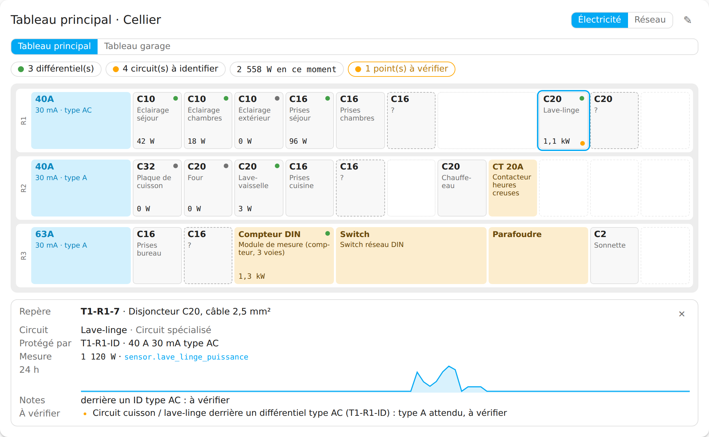
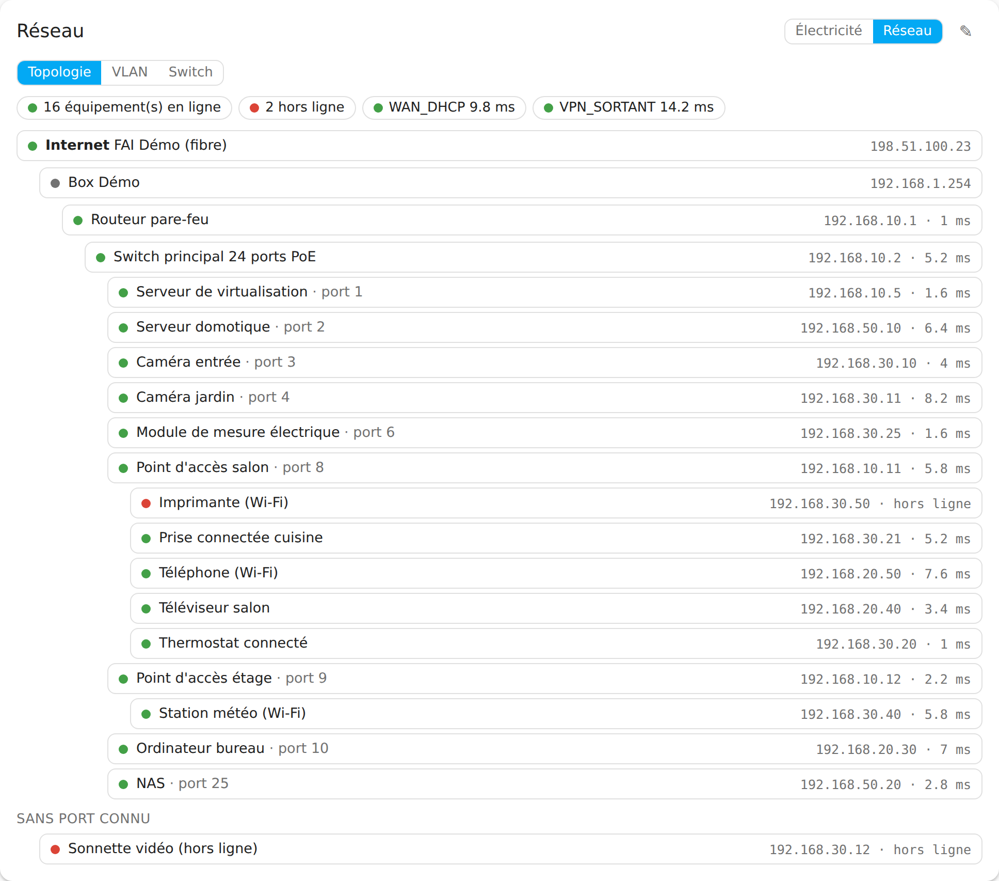
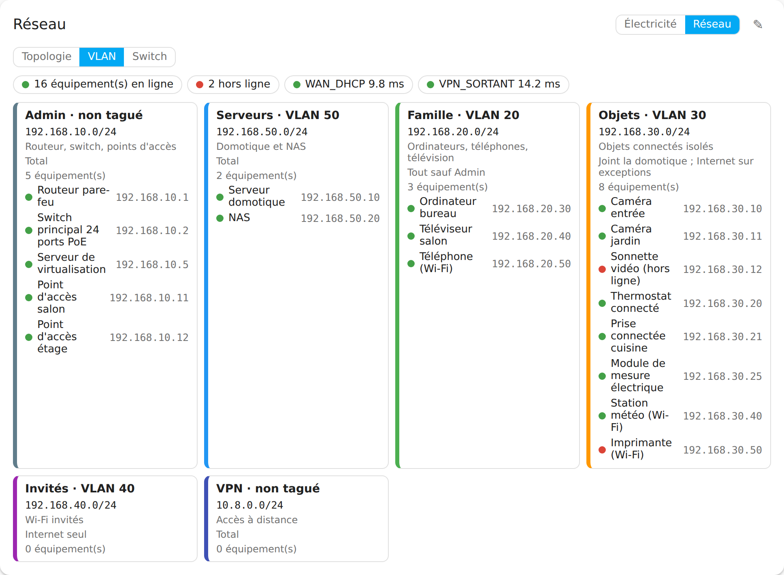
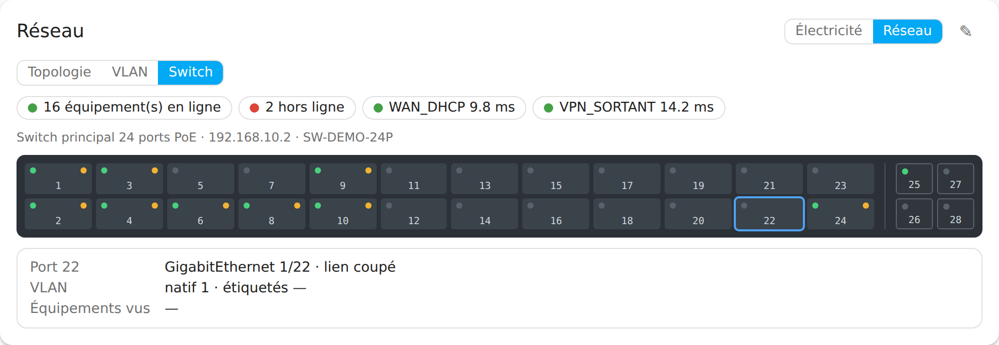
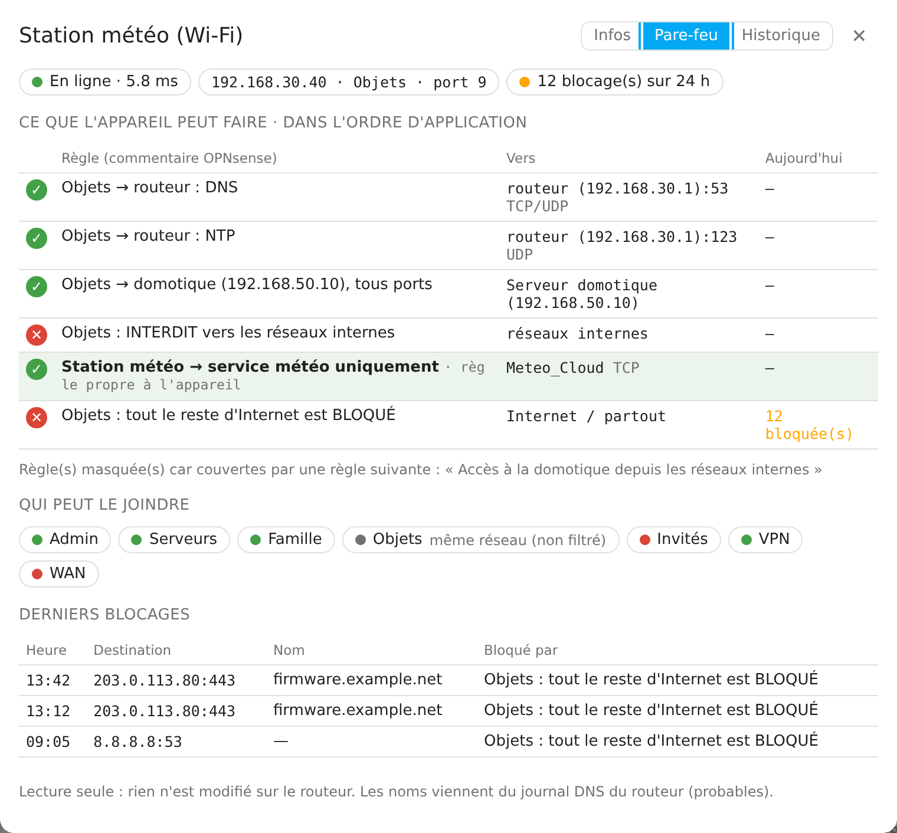
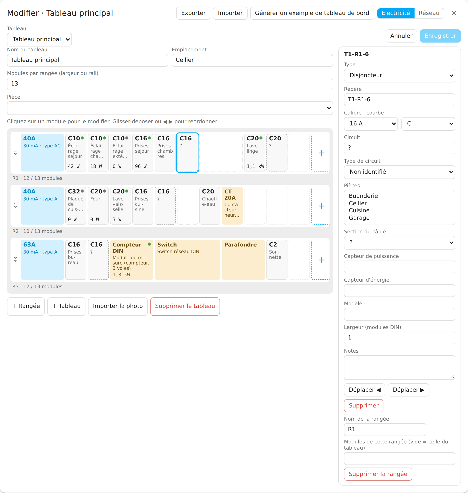
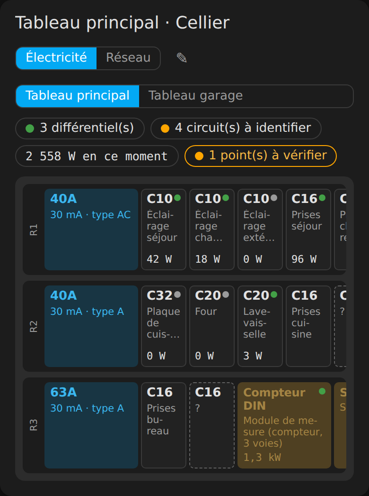

# Home Infra Map

[Version française](README.md)

A **Home Assistant** integration (installable with **HACS**) that documents and monitors the infrastructure of the house:

1. **electrical boards**: rows, RCDs, breakers, circuits, rooms served, links to your existing power sensors (Shelly…);
2. the **local network**: topology, VLANs, switch ports, devices, and the **OPNsense firewall rules** that apply to each device.

A Lovelace card `custom:home-infra-map-card` ships with the integration (nothing to add by hand): **Electricity** view (the board as it really is), **Network** view (topology, VLANs, switch front panel), a sheet per device (info, firewall, history) and an **edit mode** for administrators. The interface is in French first, with a complete English translation.

| Network · topology | Network · VLANs | Network · switch |
|---|---|---|
|  |  |  |

| Device sheet · firewall | Edit mode | Dark theme, phone |
|---|---|---|
|  |  |  |

Screenshots are produced automatically from the real card on the fictional demo house of the repository (`scripts/screenshots/`).

> **Read-only, local.** Home Infra Map never changes anything on the router or the switch (no `set`/`add`/`del`/`apply`/`reconfigure`, no SNMP SET, no SSH) and nothing leaves the local network.

## Requirements

- Home Assistant **2026.10** or newer (Python 3.14, required by HA 2026.10).
- Optional: an **OPNsense** router (tested on 26.7) with a read-only API user.
- Optional: a **managed switch** reachable with SNMP v2c or v3.

Without OPNsense or a switch, everything works with manual input: board documentation, network, device ping.

## Installation (HACS)

1. HACS → ⋮ → **Custom repositories** → `https://github.com/Eric-D/ha-home-infra-map`, category **Integration**.
2. Search **Home Infra Map** in HACS, **Download**.
3. **Restart** Home Assistant.
4. Settings → Devices & services → **Add integration** → *Home Infra Map*.

The card is registered automatically as a **dashboard resource** at startup (`/home_infra_map/home-infra-map-card.js?v=<version>`; the URL changes with each version to bust caches). If your dashboards are in **YAML mode**, add that resource yourself (type `module`): a warning in the log reminds you.

## Configuration

Everything is done in the UI: house name; optional OPNsense source (URL `http://ip:port` or `https://host`, key, secret, certificate check — tested by reading the ARP table, a 401/403 tells you whether the key is refused or **which privilege is missing**); optional SNMP switch (v2c community or v3 user/protocols/passwords — tested by reading `sysName`); finally "Import VLANs and DHCP reservations from OPNsense".

**Options**: intervals (ping 30–600 s, SNMP 60–3600 s, OPNsense 60–3600 s), default view, firewall analysis, change/remove OPNsense (leave key and secret empty to keep the current ones), add/remove switches. Keys and passwords live in the HA config entry, never in logs, entity attributes or diagnostics (redacted).

## Read-only OPNsense account

System → Access → Users → +, user `home-infra-map`. Grant **only**:

| Privilege (id) | Used for |
|---|---|
| Read only (`user-config-readonly`) | prevents any configuration change |
| Diagnostics: ARP Table (`page-diagnostics-arptable`) | IP → MAC (**required**) |
| Interfaces (`page-interfaces`) and Interfaces: VLAN (`page-interfaces-vlan`) | interfaces, subnets, VLAN tags |
| Services: Kea DHCPv4 (`page-services-kea-dhcpv4`) | reservations and leases |
| Firewall: Rules (`page-firewall-rules`, or the MVC equivalent in 26.x) | rules and port forwards |
| Firewall: Aliases (`page-firewall-aliases`) | aliases and resolved content |
| Diagnostics: Logs: Firewall (`page-diagnostics-logs-firewall`) | recent blocks, 24 h counter, resolver log |
| System: Gateways (`page-system-gateways`) | WAN / VPN gateway status |
| Diagnostics: pf info (`page-diagnostics-pf-info`) | optional |

Then **API keys → +** on the user. Only the ARP table is required; a missing optional privilege disables only the related feature. `user-config-readonly` does not block some service actions (`reconfigure`); the integration only calls read endpoints anyway, allow-listed in `opnsense.py` and checked by the tests.

## SNMP switch

SNMP **v3** `authPriv` recommended: a read-only user, MD5/SHA authentication, DES/AES privacy, read view on `1` (or at least the OIDs below). OIDs read: `sysName`, `dot1dBasePortIfIndex`, `dot1qTpFdbPort` (fallback `dot1dTpFdbPort`), `ifName`/`ifDescr`, `ifAlias`, `ifOperStatus`, `ifHighSpeed`, `dot1qPvid`, `dot1qVlanStatic{Egress,Untagged}Ports`, LLDP `lldpRemSysName`/`lldpRemPortId`, PoE `pethPsePortDetectionStatus` (when available).

## Getting started

1. **Import what you have**: house YAML files (`tableaux:` / `vlans:` / `equipements:` format) copied to `/config`, then action `home_infra_map.import_yaml` with `path: house/electricity.yaml` (the referenced photo is copied without its metadata) — or in the card: pencil → **Import** → paste.
2. **Or import from OPNsense**: Network → pencil → **Import everything from OPNsense**: preview, tick, import (VLANs + one device per DHCP reservation, presence sensor only).
3. **Complete a board**: Electricity → pencil → click a module, fill type, rating/curve, RCD (rating, sensitivity, type), circuit, rooms, power sensor… reorder with ◀ ▶ or drag and drop, **Save**.
4. **Add a device**: Network → pencil → *Add a device* → type the IP: it is pinged, the VLAN deduced, the MAC read on OPNsense and the port on the switch; tick the sensors: the `entity_id`s that will be created are shown before saving.

Non-admin users see everything but cannot edit: editing commands are **refused by the server**, not only hidden.

## Boards: widths, holes, rail size

Each module takes **N DIN slots** (18 mm): an RCD 2, a Shelly Pro 4PM 4, a DIN socket 3…; the drawing is proportional. **Holes** are "empty places" of one or more slots. A board has any number of rows and a **rail width** ("modules per row": 13, 18, 24…), which a row may override; when known, the free slots are drawn ("17 / 18 modules"), the rail fits the card width, and an overfull rail is flagged. In house YAML files: `modules_par_rangee: 18` on the board, `capacite: 13` on a row, an ordered `elements:` list of `{differentiel: …}`, `{disjoncteur: …}`, `{module: …}`, `{vide: n}`, and `largeur: n` on any item (the historical `differentiel` / `disjoncteurs` / `modules` layout is still accepted, with `{vide: n}` holes). Full example: [`docs/examples/tableau-largeurs.yaml`](docs/examples/tableau-largeurs.yaml).

## YAML file import / export

In the card (pencil): **Export** → *Download (.yaml)* (or *Copy*); **Import** → *Choose a .yaml file…* (or paste) → *Import*. The sections present in the file replace the current data; an export re-imports identically. Actions: `home_infra_map.export_yaml` / `home_infra_map.import_yaml` (paths in `/config`).

## Card examples and generated dashboard

- `docs/examples/cards.yaml`: one card configuration per view, plus an "offline" notification automation.
- **Generate a dashboard from your data**: action `home_infra_map.generate_dashboard` (or the button in the card edit mode) returns a full view (one card per electrical board with power history per row, the three network views, device presence grouped by VLAN, latency and firewall blocks) to paste in a dashboard's raw YAML editor. Nothing is written to your dashboards. Output on the demo data: [`docs/examples/dashboard.yaml`](docs/examples/dashboard.yaml).

## Entities

Each monitored device becomes an HA **device** (MAC connection when known, suggested area). Entity ids are pinned at creation, with suffixes in the system language (`en_ligne` / `online`, `latence` / `latency`, `port_switch` / `switch_port`, `blocages` / `blocks`, `puissance` / `power`):

| Entity | Example (English system) | When |
|---|---|---|
| Presence (ICMP) | `binary_sensor.home_infra_map_nas_online` | presence ticked |
| Latency (ms) | `sensor.home_infra_map_nas_latency` | latency ticked |
| TCP service | `binary_sensor.home_infra_map_nas_port_8080` | TCP port set |
| Switch port | `sensor.home_infra_map_nas_switch_port` | SNMP source + known MAC |
| Firewall blocks (24 h) | `sensor.home_infra_map_nas_blocks` | OPNsense + analysis enabled |
| Switch port state | `sensor.home_infra_map_<switch>_port_<n>` | diagnostic, disabled by default unless used |
| Row power | `sensor.home_infra_map_t1_r3_power` | at least one linked sensor |
| Board power | `sensor.home_infra_map_t1_power` | same |

Entities follow the model **without reloading the integration**.

## Services and events

`home_infra_map.import_yaml` (admin), `home_infra_map.export_yaml`, `home_infra_map.generate_dashboard`, `home_infra_map.refresh`. Events `home_infra_map_device_offline` (after the "offline alert" delay; `name`, `host`, `offline_minutes`) and `home_infra_map_device_online`; a **repair issue** also flags the offline device.

## Firewall analysis

Read-only, no packet tester: **what the device can do** (floating then interface rules by `sequence` whose source covers the device; stops after a `quick` any → any rule; device-specific rules highlighted; a pass rule fully covered by a broader pass rule further down, with no block in between, is folded as redundant), **who can reach it** (first applicable rule per VLAN, VPN and WAN, plus NAT port forwards), **recent blocks** (last 20, with the DNS name queried just before — "probable"). Cached 5 minutes. Reference case (tested, demo house): for the weather station `192.168.30.40` in the Objets VLAN the order is DNS → NTP → home server → internal networks blocked → **device rule "weather station → weather service"** → rest of the Internet blocked.

## Electrical checks

Cautious hints inspired by NF C 15-100, never blocking, **not a substitute for an electrician**: breaker without a 30 mA RCD upstream; more than 8 breakers behind one RCD; hob or washing machine behind an RCD that is not type A/F/B; rating too high for the cable (1.5 mm² > 16 A, 2.5 mm² > 20 A, 4 mm² > 25 A, 6 mm² > 32 A); lighting > 16 A, sockets > 20 A; disproportionate sum of ratings behind an RCD (info); unidentified circuits ("?"); row wider than its rail.

## Known limitations

Wi-Fi devices appear on their access point's port; switches forget idle MACs (last known port is kept with `last_seen`); ports are bridge ports (front panel numbering on mainstream switches); firewall lines are marked "probable" for URL/GeoIP aliases, unresolved names, `tagged`, policy routing, non-quick floating rules or missing `sequence`, and OPNsense automatic rules are not exposed by the API; the 24 h counter uses the last 5,000 "block" log lines; ICMP needs unprivileged ping sockets (default on HA OS and the official container) or root; IPv6 is display-only. Out of scope for v1: circuit list view, reachability tester, PDF/labels, any write to a device.

## Privacy and security

Nothing leaves the LAN (no cloud, no CDN). Nothing is changed on the router or the switch. Board photos are stored in `/config/home_infra_map/photos/` — **not** in `/config/www`, which is served without authentication — and served by an authenticated view through a signed URL; they are re-encoded without EXIF metadata and downscaled. Diagnostics contain no key, secret, SNMP password, router URL, public IP or MAC. The YAML export contains your house documentation: keep it private.

## Assumptions

Name Home Infra Map (`home_infra_map`); Python 3.14 (required by HA 2026.10); the card is a Lovelace resource (with `add_extra_js_url` only as a YAML-mode fallback, because an injected script can run before HA's scoped element registry polyfill); validation with `probatio`, which replaced voluptuous in HA 2026.10; NAT read from `POST /api/firewall/d_nat/search_rule`; offline alert as both an event and a repair issue; a single config entry, several switches; the `wifi` and `services` sections of the house files are not imported, hand-written ports are imported as `manual`.

## Development

See the commands at the end of [README.md](README.md#développement) and `CONTRIBUTING.md`. License: MIT.
