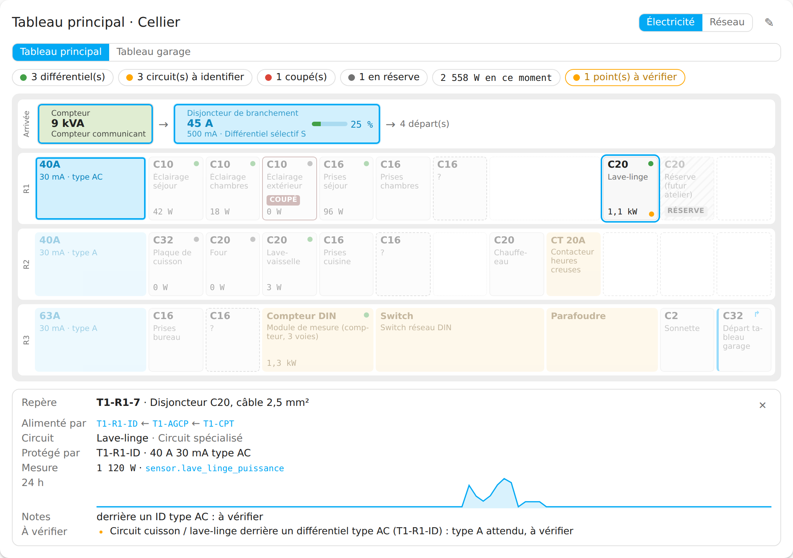
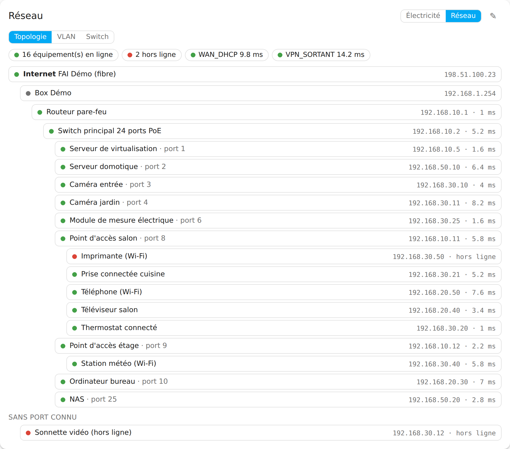
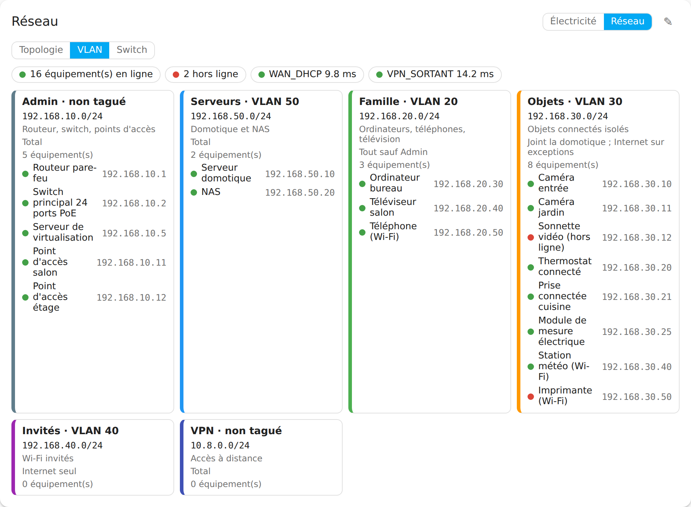
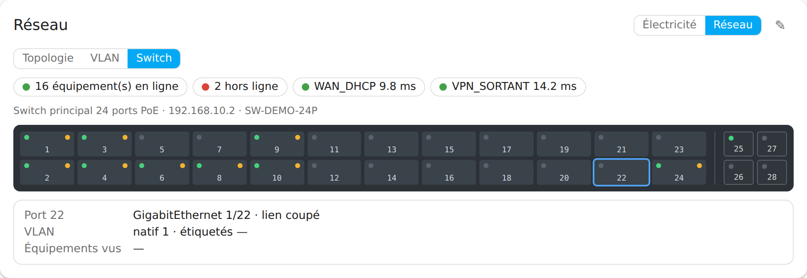
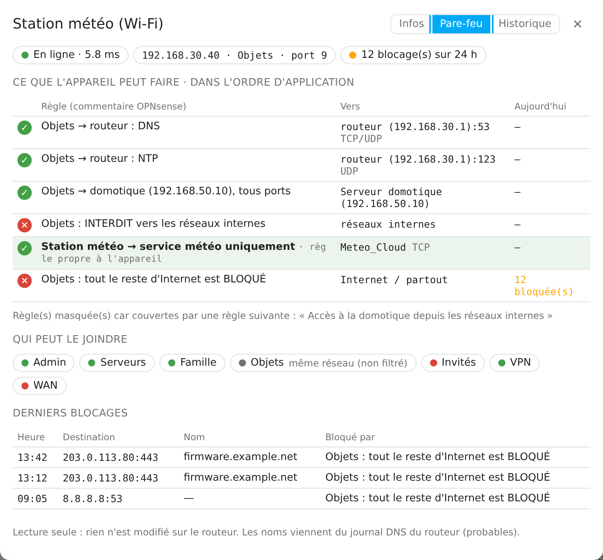
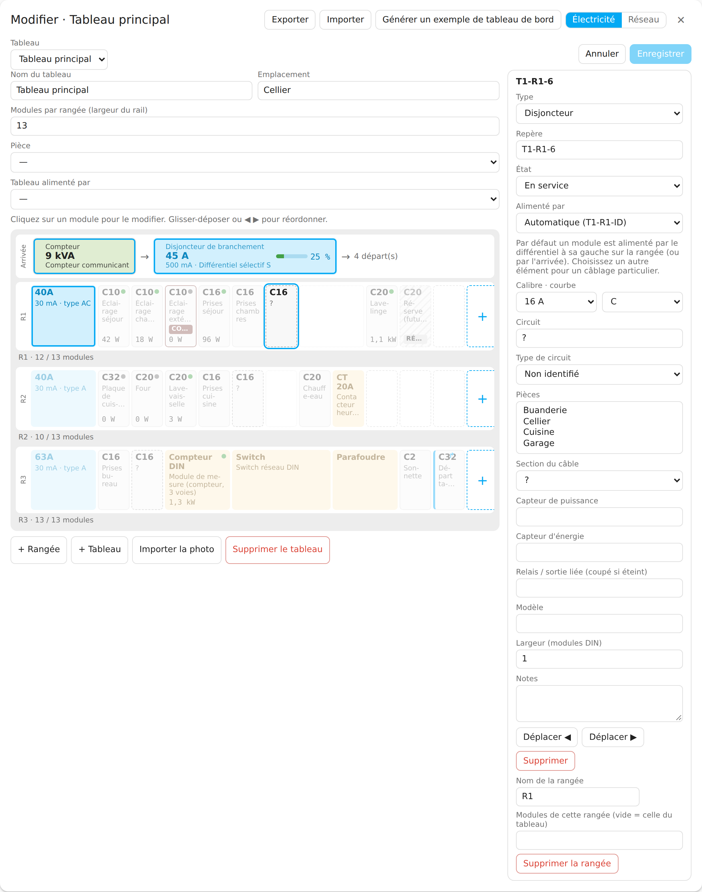
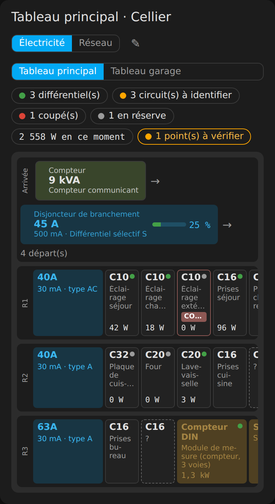

# Home Infra Map

[English version](README.en.md)

Intégration **Home Assistant** (installable par **HACS**) qui documente et supervise l'infrastructure de la maison :

1. les **tableaux électriques** : rangées, différentiels, disjoncteurs, circuits, pièces desservies, liens vers vos capteurs de puissance existants (Shelly…) ;
2. le **réseau local** : topologie, VLAN, ports du switch, équipements, et les **règles de pare-feu OPNsense** qui s'appliquent à chaque équipement.

Une carte Lovelace `custom:home-infra-map-card` est fournie avec l'intégration (rien à ajouter à la main) : vue **Électricité** (le tableau tel qu'il est), vue **Réseau** (topologie, VLAN, face avant du switch), fiche de chaque équipement (infos, pare-feu, historique) et **mode édition** pour les administrateurs.



| Réseau · topologie | Réseau · VLAN | Réseau · switch |
|---|---|---|
|  |  |  |

| Fiche équipement · pare-feu | Mode édition | Thème sombre, téléphone |
|---|---|---|
|  |  |  |

Les captures sont produites automatiquement depuis la carte réelle, sur la maison de démonstration fictive du dépôt (`scripts/screenshots/`).

> **Lecture seule, en local.** Home Infra Map ne modifie jamais rien sur le routeur ni sur le switch (aucun `set`/`add`/`del`/`apply`/`reconfigure`, aucun SNMP SET, aucun SSH) et rien ne sort du réseau local.

---

## Sommaire

- [Prérequis](#prérequis)
- [Installation (HACS)](#installation-hacs)
- [Configuration](#configuration)
- [Compte OPNsense en lecture seule](#compte-opnsense-en-lecture-seule)
- [Switch en SNMP](#switch-en-snmp)
- [Premiers pas](#premiers-pas)
- [Tableaux : largeurs, trous, taille des rails](#tableaux--largeurs-trous-taille-des-rails)
- [Arrivée, liens d'alimentation, réserve](#arrivée-liens-dalimentation-réserve)
- [Import / export en fichier YAML](#import--export-en-fichier-yaml)
- [Exemples de cartes et tableau de bord généré](#exemples-de-cartes-et-tableau-de-bord-généré)
- [Entités créées](#entités-créées)
- [Services et événements](#services-et-événements)
- [Analyse du pare-feu](#analyse-du-pare-feu)
- [Contrôles électriques](#contrôles-électriques)
- [Limites connues](#limites-connues)
- [Confidentialité et sécurité](#confidentialité-et-sécurité)
- [Hypothèses retenues](#hypothèses-retenues)
- [Développement](#développement)

## Prérequis

- Home Assistant **2026.10** ou plus récent (Python 3.14, imposé par HA 2026.10).
- Facultatif : un routeur **OPNsense** (testé sur 26.7) avec un utilisateur d'API en lecture seule.
- Facultatif : un **switch administrable** joignable en SNMP v2c ou v3.

Sans OPNsense ni switch, tout fonctionne en saisie manuelle : documentation des tableaux, réseau, ping des équipements.

## Installation (HACS)

1. HACS → menu ⋮ → **Dépôts personnalisés** → URL `https://github.com/Eric-D/ha-home-infra-map`, catégorie **Intégration**.
2. Rechercher **Home Infra Map** dans HACS, **Télécharger**.
3. **Redémarrer** Home Assistant.
4. Paramètres → Appareils et services → **Ajouter une intégration** → *Home Infra Map*.

La carte est enregistrée automatiquement comme **ressource du tableau de bord** au démarrage (`/home_infra_map/home-infra-map-card.js?v=<version>`, l'URL change à chaque version pour vider le cache). Si vos tableaux de bord sont en **mode YAML**, ajoutez cette ressource vous-même (type `module`) : un avertissement le rappelle dans le journal.

## Configuration

Tout se fait dans l'interface :

| Écran | Contenu |
|---|---|
| Bienvenue | nom de la maison |
| Source OPNsense (facultatif) | URL (`http://ip:port` ou `https://hôte`), clé, secret, vérification du certificat. Testée en lisant la table ARP ; une erreur 401/403 indique la clé refusée ou **le droit manquant**. |
| Source switch SNMP (facultatif) | hôte, version v2c/v3, communauté ou utilisateur + protocoles et mots de passe. Testée en lisant `sysName`. |
| Terminer | « Importer les VLAN et les réservations DHCP depuis OPNsense » |

**Options** (Configurer sur l'intégration) : intervalles (ping 30–600 s, SNMP 60–3600 s, OPNsense 60–3600 s), vue par défaut, analyse du pare-feu, modifier/retirer OPNsense (laisser la clé et le secret vides pour garder les actuels), ajouter/retirer des switchs.

Les clés et mots de passe sont stockés dans l'entrée de configuration de HA, jamais dans les journaux, les attributs d'entités ou les diagnostics (masqués).

## Compte OPNsense en lecture seule

Dans OPNsense : **Système → Accès → Utilisateurs → +**, utilisateur `home-infra-map`, sans accès console. Groupe : aucun. Privilèges effectifs à cocher, et **rien d'autre** :

| Privilège (identifiant) | Sert à |
|---|---|
| Lecture seule (`user-config-readonly`) | empêche toute modification de configuration |
| Diagnostics: ARP Table (`page-diagnostics-arptable`) | IP → MAC (**indispensable**) |
| Interfaces (`page-interfaces`) et Interfaces: VLAN (`page-interfaces-vlan`) | interfaces, sous-réseaux, numéros de VLAN |
| Services: Kea DHCPv4 (`page-services-kea-dhcpv4`) | réservations et baux |
| Firewall: Rules (`page-firewall-rules`, ou l'équivalent MVC en 26.x) | lecture des règles et des redirections NAT |
| Firewall: Aliases (`page-firewall-aliases`) | alias et leur contenu résolu |
| Diagnostics: Logs: Firewall (`page-diagnostics-logs-firewall`) | derniers blocages, compteur 24 h, journal du résolveur |
| System: Gateways (`page-system-gateways`) | état des passerelles WAN / VPN |
| Diagnostics: pf info (`page-diagnostics-pf-info`) | facultatif |

Puis, sur l'utilisateur, **Clés d'API → +** : un fichier `apikey.txt` contenant `key` et `secret` est téléchargé. Seule la table ARP est indispensable ; un droit facultatif manquant désactive seulement la fonction concernée (message dans le journal et à la fin de la configuration).

⚠️ `user-config-readonly` n'empêche pas certaines actions de service (`reconfigure`). Le module n'appelle de toute façon que des endpoints de lecture, listés en liste blanche dans `opnsense.py` (et vérifiés par les tests).

## Switch en SNMP

SNMP **v3** recommandé (`authPriv`). Créer sur le switch un utilisateur en lecture seule, authentification MD5 ou SHA, chiffrement DES ou AES, et une vue en lecture sur `1` (tout l'arbre) ou au minimum sur les OID ci-dessous. Désactiver v1/v2c si inutile.

OID lus : `sysName`, `dot1dBasePortIfIndex`, `dot1qTpFdbPort` (repli `dot1dTpFdbPort`), `ifName`/`ifDescr`, `ifAlias`, `ifOperStatus`, `ifHighSpeed`, `dot1qPvid`, `dot1qVlanStatic{Egress,Untagged}Ports`, LLDP `lldpRemSysName`/`lldpRemPortId`, PoE `pethPsePortDetectionStatus` (si disponible).

## Premiers pas

1. **Importer l'existant** : si vous avez des fichiers YAML de la maison (format `tableaux:` / `vlans:` / `equipements:`, voir `tests/fixtures/`), dans la carte : crayon → **Importer** → *Choisir un fichier .yaml…*. Ou copiez-les dans `/config` puis : Outils de développement → Actions → `home_infra_map.import_yaml` avec `path: maison/electricite.yaml` (la photo référencée est alors copiée, sans ses métadonnées).
2. **Ou importer depuis OPNsense** : carte → Réseau → crayon → **Tout importer depuis OPNsense** : prévisualisation, cases à cocher, puis import (VLAN + un équipement par réservation DHCP, capteur de présence seul).
3. **Compléter un tableau** : vue Électricité → crayon → cliquer un module : type, calibre/courbe, différentiel (calibre, sensibilité, type), circuit, pièces, capteur de puissance… ◀ ▶ ou glisser-déposer pour réordonner, « + » en bout de rail, **Enregistrer**.
4. **Ajouter un équipement** : Réseau → crayon → *Ajouter un équipement* → saisir l'IP : le module la ping, déduit le VLAN, lit la MAC sur OPNsense et le port sur le switch ; cocher les capteurs : les `entity_id` qui seront créés sont affichés avant de valider.

Un utilisateur non administrateur voit tout mais ne peut rien modifier : les commandes d'édition sont **refusées par le serveur**, pas seulement masquées.

## Tableaux : largeurs, trous, taille des rails

- Chaque module occupe **N places DIN** (1 place = 18 mm) : différentiel 2, Shelly Pro 4PM 4, prise DIN 3… Le dessin est proportionnel.
- Les **trous** (obturateurs, places libres au milieu d'une rangée) sont des « emplacements vides » d'une ou plusieurs places.
- Chaque tableau peut avoir un nombre quelconque de rangées, et une **largeur de rail** (« modules par rangée » : 13, 18, 24…) ; une rangée peut avoir sa propre largeur. Quand elle est connue, les places restantes sont dessinées en fin de rail (« 17 / 18 modules »), le rail s'adapte à la largeur de la carte, et un rail trop rempli est signalé.

Dans le mode édition : champ « Modules par rangée » du tableau, « Modules de cette rangée », « Largeur (modules DIN) » d'un module, bouton ▢ pour ajouter un emplacement vide.

Dans les fichiers YAML de la maison :

```yaml
tableaux:
  - id: T1
    nom: Tableau 1
    modules_par_rangee: 18          # largeur des rails
    rangees:
      - id: T1-R1
        capacite: 13                # facultatif : rail plus court sur cette rangée
        elements:                   # ordre physique, de gauche à droite
          - differentiel: {calibre: 40A, sensibilite: 30mA, type: A, largeur: 2}
          - disjoncteur: {repere: T1-R1-1, calibre: C10, circuit: Éclairage RDC}
          - vide: 4                 # trou de 4 places
          - disjoncteur: {repere: T1-R1-2, calibre: C20, sensibilite: 30mA, type: A, circuit: Lave-linge}  # disjoncteur différentiel
          - module: {type: Shelly Pro 4PM, modele: Shelly Pro 4PM, largeur: 4}
```

L'ancienne forme (`differentiel`, puis `disjoncteurs`, puis `modules`) reste acceptée ; on peut y glisser `{vide: 2}` et `largeur: n` sur chaque élément. Exemple complet (maison fictive) : [`docs/examples/tableau-largeurs.yaml`](docs/examples/tableau-largeurs.yaml).

## Arrivée, liens d'alimentation, réserve

- **Arrivée** : en mode édition, *+ Compteur* et *+ Disjoncteur de branchement* au-dessus des rails. Le compteur porte la puissance souscrite et, si vous en avez un, le capteur de puissance (TIC, pince) ; le disjoncteur de branchement affiche sa charge en % de son calibre.
- **Alimenté par** : par défaut un module est alimenté par le différentiel à sa gauche sur la rangée, sinon par l'arrivée. Pour un câblage particulier (un C40 pris directement sous le disjoncteur de branchement, hors différentiel), choisissez l'élément dans « Alimenté par » : le module est marqué ↱, et les contrôles en tiennent compte. Un tableau divisionnaire se relie au départ qui l'alimente (« Tableau alimenté par »).
- Cliquer sur un module met en évidence ce qui l'alimente et tout ce qu'il alimente.
- **État** : *coupé / disjoncté* (bordure rouge, étiquette « Coupé » ; aussi automatiquement quand le relais lié est éteint) ou *en réserve* (posé pour de futurs travaux, non raccordé : hachuré, ignoré par les contrôles).

```yaml
tableaux:
  - id: T1
    arrivee:
      compteur: {modele: Linky, puissance_souscrite: 12 kVA, entite_puissance: sensor.linky_papp}
      disjoncteur: {calibre: 60A, sensibilite: 500mA}
    rangees:
      - id: T1-R1
        elements:
          - differentiel: {calibre: 40A, sensibilite: 30mA, type: A}
          - disjoncteur: {repere: T1-R1-1, calibre: C16, circuit: Prises}
          - disjoncteur: {repere: T1-R1-2, calibre: C20, circuit: Réserve, etat: réserve}
          - disjoncteur: {repere: T1-R1-3, calibre: C40, circuit: Départ garage, alimente_par: arrivee}
  - id: T2
    alimente_par: T1-R1-3       # tableau divisionnaire
```

## Import / export en fichier YAML

- **Depuis la carte** (crayon) : **Exporter** → *Télécharger (.yaml)* enregistre un fichier `home-infra-map-export-AAAA-MM-JJ.yaml` (ou *Copier*). **Importer** → *Choisir un fichier .yaml…* (ou coller le texte) → *Importer*. Les sections présentes dans le fichier (tableaux et/ou réseau) remplacent les données actuelles ; l'export se réimporte à l'identique.
- **Par les actions** : `home_infra_map.export_yaml` (avec `path` pour écrire dans `/config`) et `home_infra_map.import_yaml` (`path` dans `/config`, la photo référencée est copiée).
- Formats acceptés à l'import : l'export natif (clés anglaises, identique au modèle stocké) et le format des fichiers de la maison (`tableaux:` / `vlans:` / `equipements:`).

## Exemples de cartes et tableau de bord généré

- `docs/examples/cards.yaml` : une configuration de carte par vue, plus une automatisation de notification « hors ligne ».
- **Générer un tableau de bord à partir de vos données** : action `home_infra_map.generate_dashboard` (ou bouton dans le mode édition de la carte). Elle renvoie une vue complète (une carte par tableau électrique avec l'historique de puissance par rangée, les trois vues réseau, la présence des équipements regroupée par VLAN, la latence et les blocages), à coller dans l'éditeur YAML d'un tableau de bord. Rien n'est écrit dans vos tableaux de bord. Exemple produit sur les données de démonstration : [`docs/examples/dashboard.yaml`](docs/examples/dashboard.yaml).

```yaml
type: custom:home-infra-map-card
view: network          # electricity | network
network_view: switch   # topology | vlan | switch
# board: <id>          # tableau affiché par défaut (vue électricité)
```

## Entités créées

Chaque équipement surveillé devient un **appareil** HA (MAC en connexion si connue, pièce suggérée). Les `entity_id` sont fixés à la création, avec des suffixes dans la langue du système (français ici) :

| Entité | Exemple | Condition |
|---|---|---|
| Présence (ICMP) | `binary_sensor.home_infra_map_nas_en_ligne` | « présence » coché |
| Latence (ms) | `sensor.home_infra_map_nas_latence` | « latence » coché |
| Service TCP | `binary_sensor.home_infra_map_nas_port_8080` | port TCP renseigné |
| Port du switch | `sensor.home_infra_map_nas_port_switch` (attributs : switch, vitesse, VLAN natif, voisin LLDP, `last_seen`) | source SNMP + MAC connue |
| Blocages pare-feu (24 h) | `sensor.home_infra_map_nas_blocages` | OPNsense + analyse activée |
| Port de switch | `sensor.home_infra_map_<switch>_port_<n>` (up/down, vitesse, PoE, équipements vus) | diagnostic ; désactivé par défaut sauf ports utilisés |
| Puissance d'une rangée | `sensor.home_infra_map_t1_r3_puissance` (W, somme des capteurs liés, indisponibles ignorés) | au moins un capteur lié |
| Puissance d'un tableau | `sensor.home_infra_map_t1_puissance` | idem |

Un disjoncteur sans capteur reste de la documentation : pas d'entité. Les entités suivent le modèle **sans recharger l'intégration** : ajouter, renommer ou supprimer un équipement crée, met à jour ou retire ses entités immédiatement (l'historique est conservé tant que l'identifiant interne ne change pas).

## Services et événements

| Action | Rôle |
|---|---|
| `home_infra_map.import_yaml` (`path`) | importe un fichier de `/config` (format natif ou format des fichiers de la maison). Administrateur. |
| `home_infra_map.export_yaml` (`path` facultatif) | renvoie (et écrit) toute la documentation en YAML, sans aucun secret |
| `home_infra_map.generate_dashboard` (`path` facultatif) | génère la vue de tableau de bord d'exemple |
| `home_infra_map.refresh` | force ping, OPNsense et SNMP |

Événements : `home_infra_map_device_offline` (après « alerte si hors ligne > N min », avec `name`, `host`, `offline_minutes`) et `home_infra_map_device_online`. Une **réparation** (Paramètres → Réparations) signale aussi l'équipement hors ligne. La notification reste à votre main (exemple dans `docs/examples/cards.yaml`).

## Analyse du pare-feu

Onglet **Pare-feu** de la fiche équipement, en lecture seule, sans testeur de paquets :

- **Ce que l'appareil peut faire** : règles flottantes puis règles de l'interface de son VLAN, par `sequence`, dont la source couvre l'IP de l'appareil (any, réseau de l'interface, IP, CIDR, alias, négation). La liste s'arrête après une règle `quick` « tout → tout » ; les règles **propres à l'appareil** (alias ou IP qui le visent lui seul) sont mises en évidence ; une règle « autoriser » entièrement couverte par une règle plus large qui suit, sans blocage entre les deux, est repliée (« redondante »).
- **Qui peut le joindre** : pour chaque autre VLAN, le VPN et le WAN, première règle qui s'applique (autorisé, bloqué, partiel), plus les redirections NAT.
- **Derniers blocages** : 20 dernières lignes du journal, heure locale, destination, règle, et le nom DNS demandé juste avant (déduit du journal du résolveur, donc « probable »).

Résultat mis en cache 5 minutes. Exemple de référence (testé, maison de démonstration) : pour la station météo `192.168.30.40` du VLAN Objets, l'ordre est DNS → NTP → serveur domotique → interdit vers les réseaux internes → **règle propre « station météo → service météo »** → reste d'Internet bloqué.

## Contrôles électriques

Avertissements prudents (« à vérifier »), jamais bloquants, inspirés de la NF C 15-100 ; ils **ne remplacent pas un électricien** : disjoncteur sans différentiel 30 mA en amont ; plus de 8 disjoncteurs derrière un différentiel ; plaque de cuisson ou lave-linge derrière un différentiel qui n'est pas de type A/F/B ; calibre trop fort pour la section (1,5 mm² > 16 A, 2,5 mm² > 20 A, 4 mm² > 25 A, 6 mm² > 32 A) ; éclairage > 16 A, prises > 20 A ; somme des calibres d'un différentiel disproportionnée (information) ; circuits non identifiés (« ? ») ; rangée qui dépasse la largeur de son rail ; départ vers un tableau divisionnaire sans 30 mA en amont (information). Les contrôles suivent les liens « alimenté par » ; les modules en réserve sont ignorés.

## Limites connues

- **Wi-Fi** : un appareil sans fil apparaît sur le port de son antenne (« via antenne X ») ; le port affiché est celui de l'antenne.
- **MAC oubliée** : le switch oublie une MAC après quelques minutes d'inactivité ; le dernier port connu est conservé avec sa date (`last_seen`).
- **Ports** : la numérotation est celle des ports de pont (`dot1dBasePort`), qui correspond à la face avant sur les switchs courants.
- **Pare-feu « probable »** : alias de type URL/GeoIP, noms non résolus, règles avec `tagged`, routage (`route-to`), règles flottantes non `quick`, règles sans `sequence` : la ligne est affichée avec la mention « probable » plutôt que d'affirmer un résultat incertain. Les règles automatiques d'OPNsense (anti-verrouillage, etc.) ne sont pas exposées par l'API et n'apparaissent pas.
- **Compteur de blocages** : calculé sur les 5 000 dernières lignes « block » du journal à chaque interrogation.
- **Ping** : HA doit pouvoir ouvrir des sockets ICMP (non privilégiés : `net.ipv4.ping_group_range`, réglé par défaut sur HA OS et le conteneur officiel ; sinon root). À défaut, les entités de présence sont `indisponibles` et un message l'explique dans le journal.
- **IPv6** : affichage seulement.
- Hors périmètre v1 : vue « liste des circuits », testeur « X peut-il joindre Y », génération PDF/étiquettes, toute écriture sur un équipement.

## Confidentialité et sécurité

- Rien ne sort du réseau local : pas de cloud, pas de CDN, la carte est un fichier unique servi par HA.
- Rien n'est modifié sur le routeur ni sur le switch (liste blanche d'endpoints, aucun SNMP SET).
- Les photos de tableau sont stockées dans `/config/home_infra_map/photos/`, **pas** dans `/config/www` (servi sans authentification sous `/local/`). Elles sont servies par une vue authentifiée (`/api/home_infra_map/photo/<id>`) via une URL signée ; à l'import, elles sont réencodées sans métadonnées EXIF (GPS, modèle de téléphone) et réduites à 2 400 px.
- Diagnostics téléchargeables sans clé, secret, mot de passe SNMP, URL du routeur, IP publique ni MAC.
- L'export YAML contient votre documentation (adresses, plan électrique) : gardez-le privé.

## Hypothèses retenues

Quand le cahier des charges laissait un choix ou qu'une information manquait, l'option la plus prudente a été retenue :

1. **Nom** : le projet s'appelle Home Infra Map (domaine `home_infra_map`, carte `custom:home-infra-map-card`) ; les `entity_id` commencent par `home_infra_map_`.
2. **Python 3.14** : HA 2026.10 l'exige (le cahier des charges mentionnait 3.13).
3. **Chargement de la carte** : ressource Lovelace plutôt que `add_extra_js_url` (gardé en repli pour le mode YAML). Sur les chargements rapides, un script injecté par `add_extra_js_url` peut s'exécuter avant le polyfill de registre d'éléments de HA et rester invisible (« Custom element doesn't exist »), erreur constatée sur un autre module du même auteur.
4. **Validation** : HA 2026.10 a remplacé voluptuous par `probatio` ; l'intégration l'utilise directement.
5. **Endpoint NAT** : `POST /api/firewall/d_nat/search_rule` (le cahier des charges cite `firewall/d_nat` sans chemin exact). En cas de 403/404, l'analyse fonctionne sans les redirections.
6. **Alerte hors ligne** : événement **et** réparation (les deux sont proposés par le cahier des charges).
7. **Entrée unique** : une seule entrée de configuration par instance ; plusieurs switchs possibles.
8. **Fichiers YAML de la maison** : les sections `wifi` et `services` ne sont pas importées (hors modèle v1) ; les ports écrits à la main sont importés en `manual` (figés) ; les clients Wi-Fi sont rattachés à l'antenne du même port.

## Développement

```bash
uv venv .venv --python 3.14
uv pip install --python .venv/bin/python -r requirements_test.txt
python scripts/manifest_requirements.py && uv pip install --python .venv/bin/python -r manifest-requirements.txt
.venv/bin/pytest --cov          # couverture >= 85 %
.venv/bin/ruff check . && .venv/bin/ruff format --check . && .venv/bin/mypy custom_components/home_infra_map
python scripts/gen_translations.py   # strings.json + translations/{en,fr}.json
(cd frontend && npm ci && npm run typecheck && npm run lint && npm test && npm run build)
git diff --exit-code custom_components/home_infra_map/www/home-infra-map-card.js
```

Le bundle de la carte est commité ; la CI vérifie qu'il correspond aux sources. Les versions sont écrites par le workflow de release à partir du tag `vX.Y.Z` (ne pas les modifier à la main). Voir `CONTRIBUTING.md` pour les pièges connus.

Licence : MIT.
